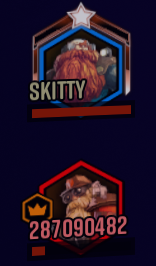
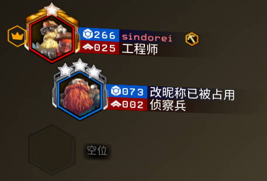

# MBPId

Deep Rock Galactic 的本地 UI 增强 mod：在服务器列表标记你已屏蔽的房主，在房内把被屏蔽玩家的名字标红，并在 ESC 玩家列表的每张卡片上添加一个「主页」按钮。

> **English summary**: MBPId is a client-side UE4SS C++ mod for Deep Rock Galactic. It marks lobbies hosted by Steam-ignored players, colors blocked teammates' names, and adds a profile button to the ESC player list. It reads the Steam ignored list live, localizes its UI into the game's 17 supported languages, and never modifies game assets or gameplay.

---

## 功能

- **服务器列表标记**：只对房主 SteamID64 命中你 Steam 屏蔽/忽略列表的房间，在地区后面插入红色 `[已屏蔽玩家]`（按游戏语言本地化）。
- **房内红名**：命中屏蔽名单的队友名字显示为红色，覆盖：
  - 游戏内左侧队友列表 `HUD_TeamDisplay_SmallItem.PlayerName`
  - 左下角本地玩家信息 `HUD_PlayerName_Label.DATA_PlayerName`
  - 空间站/选人/配装队友列表 `ITEM_SpaceRig_TeamMember.TXT_PlayerName`
- **ESC 玩家列表「主页」按钮**：自己与队友的卡片上都有，点击打开游戏内 Steam 叠加界面资料页。
- **实时 Steam 屏蔽名单**：在游戏进程内直接调用 Steamworks `ISteamFriends`，每 2 秒刷新；屏蔽/取消屏蔽后 1–3 秒内生效。
- **多语言 UI**：根据 `GameUserSettings.ini` 的 `Language=` 自动切换 `[已屏蔽玩家]` 与 `主页` 两种文案，支持 DRG 的 17 种界面语言；未知语言回退英文。详见 [`docs/TRANSLATIONS.md`](docs/TRANSLATIONS.md)。
- **纯客户端**：不改玩法、不改游戏资源、不踢人、不发送任何网络请求。

---

## 示例

### 服务器列表：已屏蔽房主标记


### 房内：被屏蔽队友红名



### ESC 玩家列表：主页按钮



---

## 工作原理

MBPId 是一个 UE4SS C++ mod（`MBPId.dll`，部署为 `main.dll`）：

1. 通过反射读取服务器列表行 `ITM_ServerList_Entry_C.Session`，调用游戏自己的 `FSDGetHostUserID` 获取房主 SteamID64。
2. 直接调用游戏已加载的 `steam_api64.dll` 中的 `ISteamFriends` 接口读取 `k_EFriendFlagIgnored` / `k_EFriendFlagBlocked`。
3. 周期性扫描、建卡、改色等 UObject/UMG 操作在游戏线程的 `UEngine::Tick` post 回调中执行；`PreConstruct` / `Click` 等 UFunction hook 回调也由游戏线程触发。
4. 只插入自己的 `TextBlock` / `Basic_ButtonCutCorner` 控件，绝不改写游戏原有文本。

> 线程模型：UE4SS 的 `on_update()` 运行在 UE4SS 自己的事件循环线程，不是游戏线程。MBPId 在 `on_update()` 中只补装/检查游戏线程 hook；周期性 UObject/UMG 工作都在 `UEngine::Tick` 回调中执行，UFunction hook 回调由游戏线程触发，避免和游戏线程销毁控件竞争。

---

## 环境要求

| 项       | 要求                                                                                       |
| ------- | ---------------------------------------------------------------------------------------- |
| 游戏      | Deep Rock Galactic Ver.1.40                                                              |
| Mod 加载器 | [RE-UE4SS](https://github.com/UE4SS-RE/RE-UE4SS) 4.0.0                                   |
| 编译      | Visual Studio 2022（MSVC 14.44 测试）、CMake 3.22+、Rust stable（RE-UE4SS 的 `patternsleuth` 依赖） |
| 系统      | Windows 10/11 x64                                                                        |
| 运行      | Steam 客户端在线；游戏目录含 `steam_api64.dll`                                                      |

RE-UE4SS 使用 CMake `FetchContent` 拉取部分第三方依赖，首次配置需要网络；请使用 `git clone --recursive` 获取 RE-UE4SS 及其子模块。

本仓库**不包含** UE4SS、Unreal Engine 头文件、游戏资源或 `steam_api64.dll`。请自行获取并遵守各自的许可证。

---

## 从源码构建

### 目录布局

```text
<workspace>/
├─ RE-UE4SS/          # git clone --recursive
└─ MBPId/             # 本仓库
   ├─ CMakeLists.txt
   ├─ src/dllmain.cpp
   ├─ data/profile_button.example.txt
   └─ docs/TRANSLATIONS.md
```

把本仓库和 `RE-UE4SS` 放在同一级目录即可。也可以在配置时通过 `UE4SS_SOURCE_DIR` 指向任意位置的 RE-UE4SS。

### 配置与编译

```powershell
cd <workspace>\MBPId
cmake -S . -B ..\build-mbpid -G "Visual Studio 17 2022" -A x64 `
      -DUE4SS_SOURCE_DIR=..\RE-UE4SS
cmake --build ..\build-mbpid --config Game__Shipping__Win64 --target MBPId
```

生成物在构建目录下，按配置查找 `MBPId.dll`，例如：

```text
..\build-mbpid\MBPId\Game__Shipping__Win64\MBPId.dll
```

建议把构建目录放在源码树外（上面的 `..\build-mbpid` 就是示例）。

如果希望构建后自动复制到游戏目录，可额外传入：

```powershell
-DMBP_DEPLOY_DIR="D:\SteamLibrary\steamapps\common\Deep Rock Galactic\FSD\Binaries\Win64\ue4ss\Mods\MBPId\dlls"
```

### 作为 RE-UE4SS 的子目录构建

也可以把本仓库放到 `RE-UE4SS/cppmods/MBPId`，在 `RE-UE4SS/cppmods/CMakeLists.txt` 中加入：

```cmake
add_subdirectory("MBPId")
```

然后按 RE-UE4SS 的常规方式构建。

---

## 安装

1. 安装 [RE-UE4SS](https://github.com/UE4SS-RE/RE-UE4SS) 4.0.0 到：
   
   ```text
   <game>\FSD\Binaries\Win64\
   ```
   
   下载页：[RE-UE4SS Releases](https://github.com/UE4SS-RE/RE-UE4SS/releases)。确保存在 `dwmapi.dll` 和 `ue4ss\` 目录。

2. 创建 mod 目录：
   
   ```text
   <game>\FSD\Binaries\Win64\ue4ss\Mods\MBPId\dlls\
   <game>\FSD\Binaries\Win64\ue4ss\Mods\MBPId\data\
   ```

3. 把 `MBPId.dll` 复制为：
   
   ```text
   ...\ue4ss\Mods\MBPId\dlls\main.dll
   ```

4. 在 `...\ue4ss\Mods\mods.txt` 中加入：
   
   ```text
   MBPId : 1
   ```

5. （可选）把 [`data/profile_button.example.txt`](data/profile_button.example.txt) 复制为：
   
   ```text
   ...\ue4ss\Mods\MBPId\data\profile_button.txt
   ```

6. 启动游戏，检查 `...\ue4ss\UE4SS.log`：
   
   ```text
   [MBPId] constructed v0.1 (game-thread updates)
   [MBPId] UI language: [已屏蔽玩家] / 主页
   [MBPId] game-thread hook: EngineTick
   [MBPId] blocklist loaded: 121 ids (source=steam)
   ```

---

## 配置

`data/profile_button.txt`（修改后重启游戏生效，不需要重新编译）：

| 键           | 默认           | 说明                                            |
| ----------- | ------------ | --------------------------------------------- |
| `action`    | `overlay`    | `overlay` / `browser` / `both`                |
| `placement` | `bottomleft` | `bottomleft` / `infobox` / `ranks` / `canvas` |
| `offset_x`  | `20`         | 设计单位，正数向右                                     |
| `offset_y`  | `5`          | 设计单位，正数向下                                     |
| `font`      | `12`         | 按钮字号                                          |
| `width`     | `50`         | 最小宽度；`0` 表示按文字自适应                             |
| `height`    | `20`         | 按钮高度                                          |

---

## 数据与诊断文件

目录：`...\ue4ss\Mods\MBPId\data\`

| 文件                   | 用途                              |
| -------------------- | ------------------------------- |
| `players.txt`        | 当前 PlayerState 的 SteamID64 + 名字 |
| `rows.txt`           | 服务器列表每行的房主 ID、是否命中、诊断信息         |
| `names.txt`          | 三处名字控件的匹配结果                     |
| `profile_diag.txt`   | 主页按钮 hook、创建、定位、点击诊断            |
| `profile_button.txt` | 主页按钮配置（可选）                      |

这些文件只用于本地诊断，可能包含 SteamID 和玩家名。

### 可选：`ignored.txt` 回退

MBPId 直接读取 Steam 实时屏蔽列表；当 Steam API 尚未初始化或不可用时，会回退读取：

```text
...\ue4ss\Mods\MBPMarker\data\ignored.txt
```

格式为每行 `SteamID64<TAB>name<TAB>flags<TAB>exported`，`#` 开头为注释。

---

## 多语言

支持以下 17 种语言：

English、Français (French)、Deutsch (German)、Español (España)、Español (Latinoamérica)、Polski (Polish)、Português (Brasil)、Русский язык (Russian)、简体中文 (Simplified Chinese)、繁體中文 (Traditional Chinese)、Українська (Ukrainian)、Italiano (Italian)、日本語 (Japanese)、한국어 (Korean)、Türkçe (Turkish)、Magyar (Hungarian)、Română (Romanian)。

语言来自：

```text
<game>\FSD\Saved\Config\WindowsNoEditor\GameUserSettings.ini
[Internationalization]
Language=...
```

切换语言后重启游戏生效。新增/修正翻译见 [`docs/TRANSLATIONS.md`](docs/TRANSLATIONS.md)。

---

## 已知限制

- 服务器列表的 `[已屏蔽玩家]` 只标记**房主**；如果被屏蔽玩家是别人房间里的队友，该行不会出现标签。
- 房内红名只覆盖上述三个 HUD 控件；ESC 玩家列表卡片和服务器列表里的玩家名不会变色。
- 红名依赖 `players.txt` 中的 PlayerState 名字→SteamID 映射；同名玩家会按歧义处理，不会误标。
- 语言切换需要重启游戏；长语言标签如果被按钮宽度截断，把 `profile_button.txt` 的 `width` 改为 `0`。
- 仅 Windows x64；仅 Steam 版 DRG；非 mod.io 发布。
- 本地客户端 mod。使用前请自行评估联机房间的 mod 政策；作者不对账号或存档风险作保证。

---

## 已知不兼容：better-server-list-filters

**与 [Better Server-List Filters](https://mod.io/g/drg/m/better-server-list-filters)（mod.io mod id `4825074`）同时启用时，服务器列表的 `[已屏蔽玩家]` 标签不可用。**

### 现象

开启 better-server-list-filters 后：

- 服务器列表**任何情况下都不显示** `[已屏蔽玩家]` 标签（初次打开、刷新、点击任何排序都不行）。
- 房内红名、ESC 玩家列表「主页」按钮**不受影响**，仍然正常。
- 卸载 better-server-list-filters 后，标签功能立即恢复正常。

**结论：这两个 mod 不能同时使用。** 需要 `[已屏蔽玩家]` 标签时请二选一。

### 已确认的原因

better-server-list-filters 是一个**重新编译过的蓝图 mod**（`.pak`），它**重写了整个服务器列表行控件蓝图** `ITM_ServerList_Entry`。把它的资产与游戏原版逐字段对比，可确认：

| 项目 | 游戏原版 | 装了 better-server-list-filters |
|---|---|---|
| 行控件内 WidgetTree 数量 | 1 | **2** |
| 蓝图代码里按属性名寻址 `TXT_Region` | 3 处 | **0 处** |

也就是说，在它的版本里 `TXT_Region` 这个控件虽然还存在，但**蓝图已经完全不再使用它来显示地区文本**——显示逻辑被改写到了别处。本 mod 依赖往 `TXT_Region` 插入/追加内容，因此在它的版本下写进去的文本不会被任何代码渲染出来。

这不是本 mod 的配置问题，也无法通过修改本 mod 绕过：**标签的载体已经被对方的资产替换掉了**。同理，任何"往行控件里塞自己的控件/改写行控件文本"的 mod 都会与它冲突；作者本人在 mod.io 页面上也写过：

> Expect incompatability with other mods that apply custom behaviour to the server-list.

### 诊断依据（供后续维护者参考）

排查过程中的可复现证据（日志位于 `<game>\FSD\Binaries\Win64\ue4ss\UE4SS.log`）：

1. 屏蔽名单、房主 SteamID 解析、扫描全部正常：
   `rows=132 hostIds=119 blocked=1 tagged=1`
2. 文本写入并且**回读校验通过**，说明写入路径本身没问题：
   `region apply: setText=true match=true readback='[CN] [已屏蔽玩家]'`
3. `rows.txt` 里该行确实记录着完整正确的文本：
   `眼虫  [CN] [已屏蔽玩家]  76561199875883481  BLOCKED  ...`
4. 但界面上始终不出现——因为该 `TXT_Region` 已不在对方的显示路径上。

`rows.txt` 的每行末尾有一列 `VISIBLE`/`hidden`，可用于确认某行是否被认为可见。

---

## 故障排查

| 现象                    | 检查                                                                                |
| --------------------- | --------------------------------------------------------------------------------- |
| 没有标签/红名               | `UE4SS.log` 是否有 `blocklist loaded ... source=steam`；`rows.txt` 的 `hostIds` 是否大于 0 |
| `source=file`         | Steam API 未就绪或 `steam_api64.dll` 未加载；确认 Steam 在线，重启游戏                             |
| 没有 `game-thread hook` | 看日志是否回退到 `GameViewportClientTick` / `ProcessEvent`；若都没有，发日志                       |
| 队友名字不红                | 看 `players.txt` 是否有该玩家 ID；看 `names.txt` 的 lookup 列                                |
| 按钮位置不对                | 调 `profile_button.txt` 的 `placement` / `offset_x` / `offset_y`                    |
| 游戏内崩溃                 | 保留 `ue4ss\crash_*.dmp` 和 `FSD.log`，附上 `UE4SS.log`                                 |

---

## 许可证

本项目以 **GNU General Public License v2.0 or later** 发布，见 [`LICENSE`](LICENSE)。

- 本仓库只包含原创 mod 代码、文档和示例配置。
- [RE-UE4SS](https://github.com/UE4SS-RE/RE-UE4SS) 使用 MIT 许可证，与本项目兼容；本仓库不包含 RE-UE4SS 源码或二进制。
- 不包含 Unreal Engine 代码/头文件、Deep Rock Galactic 资源或 `steam_api64.dll`。
- Steamworks 接口由游戏/Steam 客户端在运行时提供，本项目不重新分发 Valve 的 SDK。

GPL-2.0 与 UE4SS 的 MIT 许可证兼容；发布编译后的 DLL 时，请同时提供本仓库源码或明确的源码获取方式。

---

## 致谢

- [UE4SS / RE-UE4SS](https://github.com/UE4SS-RE/RE-UE4SS) — C++ modding API 与 hook 基础设施
- Deep Rock Galactic 社区 — UI 控件路径、资产结构与测试反馈
- 所有参与测试和翻译的玩家

